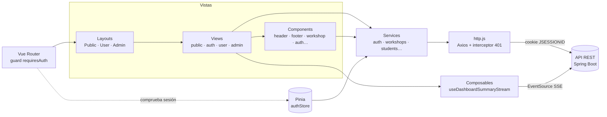
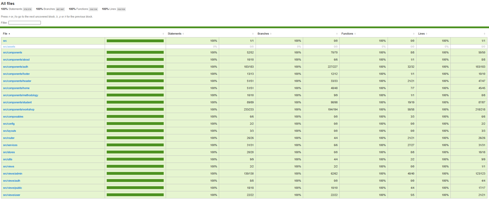

# 🎓 EducAlba · Frontend

Web de **EducAlba**, academia de refuerzo escolar y talleres extraescolares. Incluye la parte pública de la academia (inicio, talleres, refuerzo, quiénes somos, qué hacemos, galería y contacto), el registro y login de familias y los paneles privados de la familia y del administrador.

> 🔗 **Backend:** [web-educAlba-backend](https://github.com/duran-ni/web-educAlba-backend)
> 🎨 **Diseño en Figma:** _(enlace pendiente)_
> 🎤 **Presentación:** _(enlace pendiente)_

---

## 🔍 Índice

- [Descripción](#-descripción)
- [Capturas](#-capturas)
- [Tecnologías utilizadas](#-tecnologías-utilizadas)
- [Instalación](#️-instalación)
- [Scripts disponibles](#-scripts-disponibles)
- [Estructura de carpetas](#-estructura-de-carpetas)
- [Arquitectura](#-arquitectura)
- [Rutas de la aplicación](#-rutas-de-la-aplicación)
- [Diseño responsive y estilos](#-diseño-responsive-y-estilos)
- [Accesibilidad](#-accesibilidad)
- [Tests](#-tests)
- [Integración continua](#-integración-continua)
- [Metodología de trabajo](#-metodología-de-trabajo)
- [Autora](#️-autora)

---

## 📝 Descripción

EducAlba ofrece clases de refuerzo (Infantil, Primaria y ESO), técnicas de estudio y talleres temáticos. La web permite:

**Visitantes**
- Consultar los talleres en un calendario y en un listado, e **inscribirse** sin necesidad de cuenta.
- Ver la galería de fotos, la metodología y la historia de la academia.
- Enviar el formulario de contacto o el formulario rápido de interés de la portada.

**Familias (`ALUMNO_FAMILIA`)**
- Registrarse junto con los datos del alumno, iniciar sesión (con opción "recordarme") y recuperar la contraseña por email.
- Consultar su panel con los talleres en los que está inscrito el alumno.

**Administración (`ADMINISTRADOR`)**
- Ver los indicadores de la academia **actualizados en tiempo real**.
- Crear y gestionar talleres y dar de alta alumnos.

---

## 📷 Capturas

<!-- Sustituir por capturas reales de la aplicación (escritorio y móvil) -->
| Escritorio | Móvil |
|-----------|-------|
| _(captura de Inicio)_ | _(captura de Inicio)_ |
| _(captura de Talleres)_ | _(captura del menú hamburguesa)_ |
| _(captura del Panel de Administración)_ | _(captura del Panel de la familia)_ |

---

## 💻 Tecnologías utilizadas

| Categoría | Tecnología |
|-----------|-----------|
| Framework | Vue 3 (Composition API, `<script setup>`) |
| Build | Vite |
| Enrutado | Vue Router 4 (lazy loading y guard de autenticación) |
| Estado global | Pinia |
| Peticiones HTTP | Axios (instancia única con interceptores) |
| Estilos | Sass (SCSS modular) + metodología BEM, mobile-first |
| Tests unitarios y de componentes | Vitest + Vue Test Utils + jsdom |
| Tests end-to-end | Playwright (Chromium, Firefox y WebKit) |
| Cobertura | @vitest/coverage-v8 |
| Calidad de código | ESLint + Prettier |
| CI | GitHub Actions |

---

## 🛠️ Instalación

### Requisitos previos

- Node.js 22 o superior
- El [backend](https://github.com/duran-ni/web-educAlba-backend) arrancado en `http://localhost:8080`

### Pasos

**1.** Clonar el repositorio:

```bash
git clone https://github.com/duran-ni/web-educAlba-frontend.git
cd web-educAlba-frontend
```

**2.** Instalar las dependencias:

```bash
npm install
```

**3.** Crear el archivo `.env` a partir del ejemplo:

```bash
cp .env.example .env
```

```env
VITE_API_URL=http://localhost:8080/api
```

**4.** Arrancar el servidor de desarrollo:

```bash
npm run dev
```

La aplicación queda disponible en `http://localhost:5173`.

---

## 📜 Scripts disponibles

| Script | Descripción |
|--------|-------------|
| `npm run dev` | Servidor de desarrollo con recarga en caliente |
| `npm run build` | Compila la aplicación para producción en `dist/` |
| `npm run preview` | Sirve la build de producción en local |
| `npm run test:unit` | Tests unitarios y de componentes (modo watch) |
| `npm run test:unit:coverage` | Tests unitarios con informe de cobertura |
| `npm run test:e2e` | Tests end-to-end con Playwright |
| `npm run lint` | Revisa y corrige el código con ESLint |
| `npm run format` | Formatea el código con Prettier |

---

## 📁 Estructura de carpetas

```
src
├── assets          # Imágenes y logo
├── components      # Componentes reutilizables, agrupados por área
│   ├── about       ├── auth        ├── footer      ├── gallery
│   ├── header      ├── home        ├── methodology ├── student
│   └── workshop
├── composables     # Lógica reutilizable (useDashboardSummaryStream)
├── config          # Constantes compartidas (roles, datos de contacto)
├── layouts         # PublicLayout, UserLayout, AdminLayout
├── router          # Rutas y guard de autenticación
├── services        # Llamadas a la API, una por recurso (auth, workshops…)
├── stores          # Stores de Pinia (auth)
├── styles          # SCSS: abstracts (variables, mixins), base, components
├── utils           # Funciones puras (formato de fechas y horas)
└── views           # Vistas por área: public, auth, user, admin
```

Cada carpeta tiene su propia carpeta `__tests__` con los tests de sus archivos.

---

## 🧱 Arquitectura



**Decisiones técnicas destacadas**

- **Capa de servicios**: los componentes nunca usan Axios directamente; llaman a funciones `async` de `services/`, que a su vez usan una única instancia `http.js`. Así la URL base, las cookies y el manejo de errores están en un solo sitio.
- **Interceptor de 401**: si la sesión caduca a mitad de uso, se redirige al login automáticamente. Las peticiones donde un 401 es normal (comprobar sesión al arrancar, login con credenciales incorrectas) lo desactivan con `skipAuthRedirect`.
- **Sesión por cookie, no por token en `localStorage`**: el login envía HTTP Basic una sola vez y a partir de ahí viaja la cookie `JSESSIONID` (`withCredentials: true`), que no es accesible desde JavaScript.
- **Comprobación de sesión antes de montar la app** (`main.js`): al recargar la página en `/admin` o `/dashboard`, el usuario no es expulsado si su sesión sigue siendo válida.
- **Layouts anidados en el router**: cada área (pública, familia, administración) tiene su propio layout con su cabecera y pie, sin lógica condicional en `App.vue`.
- **Lazy loading** de todas las vistas con `import()` dinámico para reducir la carga inicial.
- **Tiempo real con Server-Sent Events**: el composable `useDashboardSummaryStream` abre un `EventSource` y refresca los indicadores del administrador cuando el backend avisa de un cambio; la conexión se cierra sola al salir de la vista (`onUnmounted`).
- **Contraseña codificada en Base64** antes de enviarla; el backend la decodifica y la cifra con BCrypt.

---

## 🗺️ Rutas de la aplicación

| Ruta | Vista | Acceso |
|------|-------|--------|
| `/` | Inicio | Público |
| `/talleres` | Talleres (calendario, listado e inscripción) | Público |
| `/refuerzo` | Refuerzo por etapas | Público |
| `/quienes-somos` | Quiénes somos | Público |
| `/que-hacemos` | Qué hacemos | Público |
| `/galeria` | Galería | Público |
| `/contacto` | Contacto y mapa | Público |
| `/login` · `/registro` | Login y registro | Público |
| `/recuperar-contrasena` · `/restablecer-contrasena` | Recuperación de contraseña | Público |
| `/dashboard` | Panel de la familia | Sesión iniciada |
| `/admin` · `/admin/alumnos` | Panel de administración y alumnos | Sesión iniciada |
| `/*` | Página 404 | Público |

---

## 🎨 Diseño responsive y estilos

- **Mobile-first** con dos breakpoints (`768px` tablet y `1024px` escritorio) aplicados mediante el mixin `respond-to`.
- **SCSS modular**: `abstracts` (variables y mixins, inyectados automáticamente en cada componente desde `vite.config.js`), `base` (reset) y `components` (estilos compartidos).
- **Metodología BEM** en todos los componentes (`bloque__elemento--modificador`): cada componente usa su propio bloque como prefijo, lo que evita colisiones de estilos entre componentes.
- **Identidad visual "cuaderno / doodle"**: fondo cuadriculado, tipografías Space Grotesk, Be Vietnam Pro y Playwrite IN, y paleta de colores definida en `_variables.scss`.
- **Menú hamburguesa** en móvil.

---

## ♿ Accesibilidad

- HTML semántico (`header`, `nav`, `main`, `section`, `article`, `footer`) y jerarquía de encabezados en cada vista.
- Formularios accesibles: cada campo con su `label`, errores enlazados con `aria-describedby` y marcados con `aria-invalid`, y mensajes anunciados con `role="alert"` / `aria-live`.
- Menú de navegación móvil con `aria-expanded` y `aria-controls`.
- Iconos decorativos ocultos a los lectores de pantalla con `aria-hidden`.
- Al cambiar de página, el scroll vuelve al inicio.
- Los atributos ARIA del menú (`aria-expanded`, `aria-controls`) están cubiertos por tests de componentes, y los tests end-to-end localizan los elementos por su rol accesible.

---

## ✅ Tests

**Tests unitarios y de componentes** con Vitest y Vue Test Utils: más de 270 tests en 66 archivos que cubren componentes, vistas, layouts, router, servicios, store, composables y utilidades.

```bash
npm run test:unit            # modo watch
npm run test:unit:coverage   # con informe de cobertura (coverage/index.html)
```

**Cobertura actual: 100 % de sentencias, ramas, funciones y líneas.**



**Tests end-to-end** con Playwright en Chromium, Firefox y WebKit (navegación, rutas protegidas y página 404). Playwright arranca automáticamente el servidor de desarrollo:

```bash
npx playwright install   # solo la primera vez
npm run test:e2e
```

---

## 🔄 Integración continua

En cada `push` y `pull request` a `main` y `dev`, GitHub Actions (`.github/workflows/ci.yml`):

1. Instala Node 22 y las dependencias (`npm ci`).
2. Pasa ESLint.
3. Ejecuta los tests unitarios.
4. Ejecuta los tests end-to-end con Playwright y guarda el informe como artefacto.
5. Compila la build de producción.

---

## 📋 Metodología de trabajo

- **Diseño previo**: prototipos de todas las vistas antes de programar y diseño final en Figma.
- **Gestión ágil en Jira**: una épica por vista o área, con historias de usuario, criterios de aceptación y subtareas.
- **Git Flow simplificado**: `main` (estable) ← `dev` (integración) ← una rama `feature/…` por tarea.
- **Commits atómicos** con [Conventional Commits](https://www.conventionalcommits.org/es/) (`feat:`, `fix:`, `test:`, `style:`, `refactor:`…).

---

## ✍️ Autora

**Nieves Durán** — [@duran-ni](https://github.com/duran-ni)

Proyecto final del Bootcamp Java Fullstack de Factoría F5.
